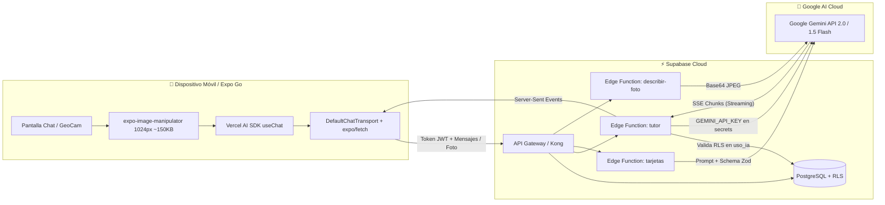

# 🤖 Tutor IA & GeoCam con IA — IA Generativa Multimodal y Edge AI

Repositorio completo del proyecto **Asistente IA Multimodal y Edge AI** correspondiente a la **Semana 10 y 11** de **Programación Móvil Avanzada (Universidad de La Guajira)** para el **Taller Integrador 2** (entregado bajo el tag oficial `v2.0.0`).

Desarrollado con **React Native (Expo SDK 58 / Expo SDK 57)**, **Expo Router**, **Supabase PostgreSQL & Auth**, **Supabase Edge Functions en Deno**, **Vercel AI SDK v7** y **Google Gemini (Multimodal Vision & Streaming LLM)**.

> [!IMPORTANT]
> **Regla de Oro de Seguridad:** La API key de Google Gemini nunca viaja a la app ni se expone en variables `EXPO_PUBLIC_*` en el bundle de JavaScript. Se custodia de manera exclusiva en los secretos seguros de las Supabase Edge Functions con autenticación y cuotas controladas en backend.

---

## 🏛️ Arquitectura del Sistema



---

## 🚀 Implementación de los Retos de la Guía (C1 a C6 y Taller)

### 1. Streaming en Tiempo Real (Reto Principal)
* Utiliza `expo/fetch` integrado en `DefaultChatTransport` para leer el flujo Server-Sent Events (SSE) token por token.
* Respuestas generadas en menos de 1 segundo sin esperar a que el modelo complete todo el texto.
* Polyfills síncronos de `structuredClone`, `TextEncoderStream` y `TextDecoderStream` en [`polyfills.ts`](./polyfills.ts) para compatibilidad total con el motor Hermes en iOS y Android.

### 2. Reto C1 · Historial Persistente y Reinicio
* La conversación se almacena localmente y se restaura automáticamente al iniciar la app.
* Botón de reinicio rápido (🗑️) en el encabezado superior para vaciar la sesión y comenzar un nuevo tema pedagógico.

### 3. Reto C2 · Instrucciones con Perfil del Estudiante
* Modal interactivo accesible desde el botón superior izquierdo **`👤 Perfil`** ([`components/ModalPerfil.tsx`](./components/ModalPerfil.tsx)).
* Permite definir **Nombre**, **Tema de Interés** (Hooks, SQLite, Navegación, etc.) y **Nivel** (*Principiante*, *Intermedio*, *Avanzado*).
* El perfil viaja en el `body` de la petición y la Edge Function lo valida con **Zod**, adaptando el prompt de sistema (`instructions`) para personalizar el tono y profundidad de las respuestas.

### 4. Reto C3 · Salida Estructurada (Tarjetas de Repaso / Flashcards)
* Botón superior derecho **`🗂️ Tarjetas`** ([`components/ModalTarjetas.tsx`](./components/ModalTarjetas.tsx)).
* La Edge Function `tarjetas` ([`supabase/functions/tarjetas/index.ts`](./supabase/functions/tarjetas/index.ts)) utiliza `generateText` con `Output.object({ schema: EsquemaZod })` para sintetizar de 3 a 5 tarjetas de evaluación con `{ pregunta, respuesta }`.
* Interfaz interactiva de tarjetas giratorias: **toca la tarjeta para voltearla** y verificar tu respuesta.

### 5. Reto C4 · Manejo de Errores y Modo Fuera de Red
* Monitoreo activo de conectividad con `useNetworkState` de `expo-network`.
* Despliegue de banner de advertencia ([`components/BannerSinRed.tsx`](./components/BannerSinRed.tsx)) cuando se corta la señal o se activa el Modo Avión.
* Bloqueo inteligente de botones de envío y cámara sin red, y botón para detener la generación en curso (**■** Stop).

### 6. Reto C5 · Límite de Uso Diario por Usuario
* Tabla `public.uso_ia` con **Row Level Security (RLS)** en Supabase ([`supabase/migrations/20261109_init.sql`](./supabase/migrations/20261109_init.sql)).
* La Edge Function consulta el cliente autenticado del usuario (`ctx.supabase`) para contar las peticiones de las últimas 24 horas.
* Al alcanzar el límite configurable (`LIMITE_DIARIO`), responde con código HTTP `429` y un mensaje amigable: *"Has alcanzado el límite diario de consultas. Vuelve mañana."*.

### 7. Taller GeoCam ve · Visión Multimodal (T1 a T6)
* Optimización de imágenes en el cliente mediante `expo-image-manipulator`: comprime fotos tomadas con la cámara o galería a 1024 px de ancho y JPEG 0.7 (~150 KB en base64).
* Edge Function `describir-foto` ([`supabase/functions/describir-foto/index.ts`](./supabase/functions/describir-foto/index.ts)) que devuelve un JSON `{ descripcion: "..." }`.
* Migración SQL que agrega la columna `ai_description` a la tabla `photos`.

### 8. Reto C6 · Bitácora de IA y Matriz de Pruebas
* [`AI-LOG.md`](./AI-LOG.md): Registro detallado de prompts, código manual vs generado, corrección de modelos retirados y refactorización de Vercel AI SDK v4/v5 a v7.
* [`PRUEBAS.md`](./PRUEBAS.md): Matriz de 10 escenarios de prueba (modo avión, límite 429, streaming, token vencido, inspección de bundle contra `AIza`) y las respuestas a las preguntas de sustentación.

---

## 📂 Estructura del Código

```text
├── app/
│   ├── _layout.tsx              # Importa polyfills y define el stack de navegación
│   ├── index.tsx                # Pantalla principal del Tutor IA (chat, chips, modales)
│   └── login.tsx                # Autenticación con Supabase
├── components/
│   ├── BannerSinRed.tsx         # Aviso visual ante pérdida de internet (Reto C4)
│   ├── Burbuja.tsx              # Renderizado de mensajes de texto y fotos con avatares
│   ├── ModalPerfil.tsx          # Configuración del perfil de estudiante (Reto C2)
│   └── ModalTarjetas.tsx        # Flashcards interactivas de repaso (Reto C3)
├── lib/
│   ├── chatTransport.ts         # Transporte nativo AI SDK v7 con streaming resiliente
│   ├── foto.ts                  # Selector y compresor a 1024px con ImageManipulator
│   ├── perfil.ts                # Persistencia del perfil con Expo SecureStore
│   └── supabase.ts              # Cliente Supabase configurado con SecureStore
├── services/
│   └── vision.ts                # Invocación a la función de visión para GeoCam
├── supabase/
│   ├── functions/
│   │   ├── tutor/index.ts       # Edge Function principal (Streaming + C2 + C5)
│   │   ├── tarjetas/index.ts    # Edge Function de salida estructurada Zod (C3)
│   │   └── describir-foto/index.ts # Edge Function de análisis visual GeoCam
│   └── migrations/
│       └── 20261109_init.sql    # Tabla uso_ia con RLS y columna ai_description
├── AI-LOG.md                    # Bitácora de prompts y auditoría técnica
├── PRUEBAS.md                   # Matriz de validación y preguntas de defensa
└── package.json                 # Expo SDK 58, React 19 y Vercel AI SDK
```

---

## 🛠️ Configuración y Puesta en Marcha

### 1. Variables de Entorno (`.env`)
Crea tu archivo `.env` en la raíz (no se incluye en git):
```env
EXPO_PUBLIC_SUPABASE_URL=https://gavwbpnjuxzyuxwlybnf.supabase.co
EXPO_PUBLIC_SUPABASE_PUBLISHABLE_KEY=sb_publishable_xxxxxxxxxxxxxxxxxx
```

### 2. Base de Datos en Supabase
Ejecuta el script [`supabase/migrations/20261109_init.sql`](./supabase/migrations/20261109_init.sql) desde el **SQL Editor** del dashboard de tu proyecto en Supabase para crear la tabla de control de uso y habilitar las políticas de seguridad RLS.

### 3. Despliegue de Edge Functions (Supabase CLI)
```bash
# 1. Vincular tu proyecto
npx supabase link --project-ref TU_PROJECT_REF

# 2. Configurar la clave secreta de Gemini en el backend seguro
npx supabase secrets set GEMINI_API_KEY=AIzaSy...

# 3. (Opcional) Configurar el límite de peticiones diarias
npx supabase secrets set LIMITE_DIARIO=20

# 4. Desplegar las funciones
npx supabase functions deploy tutor
npx supabase functions deploy tarjetas
npx supabase functions deploy describir-foto
```

### 4. Iniciar la Aplicación Móvil
```bash
# Instalar dependencias
npm install

# Iniciar Metro Bundler
npx expo start -c
```
Escanea el código QR desde **Expo Go** en tu dispositivo físico iOS o Android.

---

## 🛡️ Preguntas de Sustentación (Defensa del Proyecto)

1. **¿Dónde está tu API key de Gemini y cómo lo demuestras?**
   * La clave reside única y exclusivamente en los secretos cifrados de Supabase (`supabase secrets`), nunca en el binario móvil ni en `.env`. Se demuestra inspeccionando el bundle compilado (`grep -rn "AIza" .`), donde no arroja ninguna coincidencia, y comprobando que una llamada HTTP sin token a la Edge Function responde de inmediato `401 Unauthorized`.
2. **¿Qué ocurre si alguien envía un perfil manipulado o datos falsos por HTTP?**
   * La Edge Function implementa un validador con **Zod** (`PerfilEsquema.parse(...)` con `.catch(...)`). Si se envían campos inválidos o inyecciones, Zod sanitiza la estructura y asigna los valores seguros por defecto.
3. **¿Por qué el límite se cuenta con el cliente del usuario y no con la secret key?**
   * Porque el cliente del usuario viaja con el token de sesión y respeta el **Row Level Security (RLS)** de la tabla `uso_ia`. Esto garantiza que cada usuario únicamente pueda contabilizar sus propias solicitudes sin poder inspeccionar ni alterar los registros de otros estudiantes.
4. **¿Qué se almacena en el teléfono y qué se envía a Google?**
   * En el teléfono se almacenan las preferencias locales en `SecureStore` y el historial reciente de chat. A Google únicamente se le transmiten los últimos 20 mensajes de texto y la fotografía reducida a 1024 px (~150 KB).

---

## 🏷️ Versión y Licencia

* **Tag oficial:** `v2.0.0`
* Desarrollado para fines académicos en la Universidad de La Guajira — 2026.
